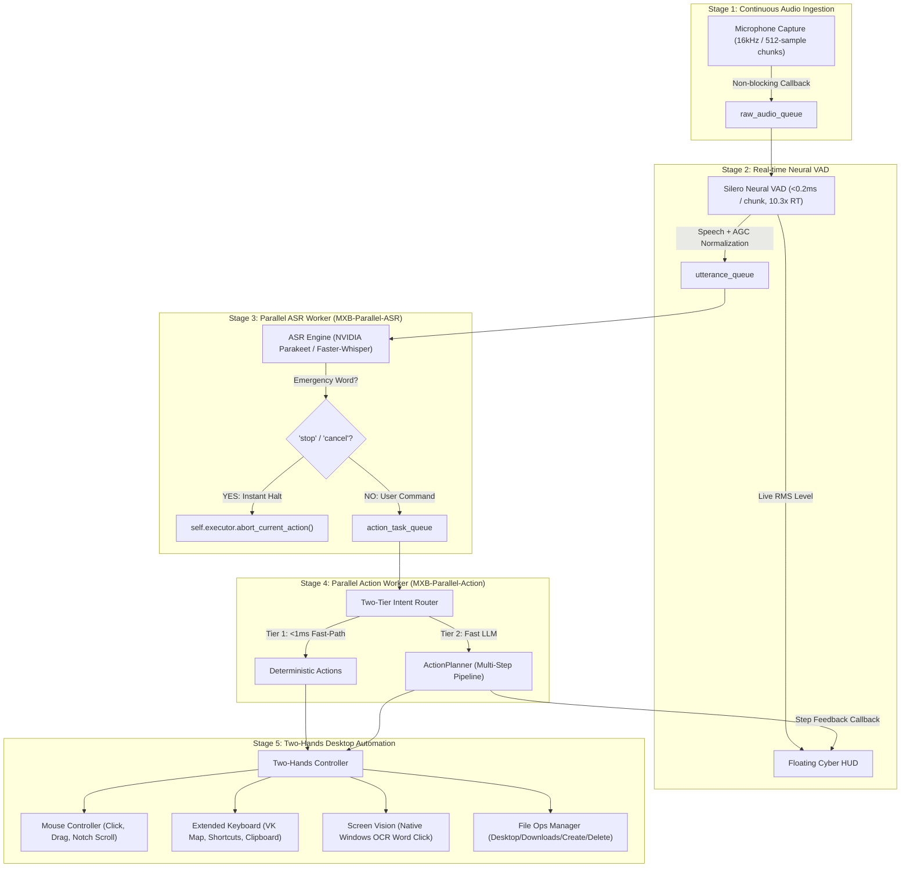

# 🧠 MXB (Machine eXecutive Brain) v4.0 — Advanced AI Desktop Companion
> Talk, type, or use your phone. It listens while it works, sees the screen as numbered elements, remembers you, answers from your documents, runs your routines on a schedule — and asks before anything destructive.

[](https://github.com/Madhu-36/MXB)
[](https://github.com/Madhu-36/MXB)
[](https://github.com/Madhu-36/MXB)
[](https://github.com/Madhu-36/MXB)
[](https://github.com/Madhu-36/MXB)

**MXB** is an autonomous desktop companion for Windows. It listens continuously, understands voice **or** typed chat, and operates your computer in parallel—acting as your digital **"two hands"** (mouse, keyboard, screen, apps, files, Bluetooth, Wi-Fi, audio, display) while you keep talking to it.

---

## 🚀 What's new in v4.0 — Advanced

| Area | What you can do | How it works |
| :--- | :--- | :--- |
| **Smarter agent** | *"show numbers"* → *"click 12"* / *"type hello in 3"*; *"agent: log into the portal and download my marksheet"* | Set-of-Marks numbering of every clickable element (`ui/marks_overlay.py`), native tool calling with an enum of valid actions, step verification (`expect`), stuck detection, banned repeated failures (`engine/agent_loop.py`) |
| **Undo** | *"undo the move"*, *"undo that"* | Journal of every file move/rename/copy/create/delete/overwrite with backups and Recycle Bin restore (`engine/undo.py`) |
| **Real-time voice** | Talk over MXB to interrupt it; replies start ~1 s after you stop speaking; natural Indian-English neural voice | Streams the LLM plan and speaks the `reply` sentence by sentence (`engine/streaming.py`); edge-tts / Piper / SAPI with gap-free prefetch (`engine/tts.py`); barge-in with echo filter (`engine/barge_in.py`); offline openWakeWord engine (`engine/wake_engine.py`) |
| **Memory** | *"I prefer short answers"* (learned automatically), *"what do you remember about me"*, *"forget my old address"* | SQLite + embeddings (Ollama / NVIDIA / local fallback), never stores secrets (`engine/semantic_memory.py`) |
| **Your documents** | *"index my Notes folder"* → *"what do my notes say about the SIH deadline?"* | Incremental indexing of TXT/MD/code/PDF/DOCX, hybrid retrieval, cited answers, permission-aware (`engine/knowledge.py`) |
| **Phone remote** | *"turn on phone remote"* → scan QR → chat, Stop, Yes/No and live screen peek from your phone | Token-secured LAN web app, private-network only, lockout on bad tokens (`engine/remote_server.py`) |
| **Reminders & schedules** | *"remind me at 5 pm to call mom"*, *"every weekday at 9 am open outlook"* | Natural-language times, persistent jobs, scheduled commands still need "yes" for risky actions (`engine/scheduler.py`) |
| **Routines & recording** | *"create a routine called work mode: open vs code; open chrome"*, *"start recording expense report"* … *"stop recording"* → *"run expense report"* | Replays clicks by element name with coordinate fallback; password fields never recorded (`engine/routines.py`) |
| **Plugins** | Drop a `.py` into `plugins/` (examples: quick notes, play on YouTube) | `@skill` decorator: regex fast-path + automatically added to the LLM's tool list (`engine/skills.py`) |

---

## 🆕 What's new in v3.0 — Companion

| Capability | What you can say or type | How it works |
| :--- | :--- | :--- |
| **Voice + text, one conversation** | Type in the chat window, or say *"MXB, …"* | `engine/command_bus.py` feeds both into the same brain; `ui/chat.py` shows every message, reply and live step |
| **Works while it listens** | *"MXB, what's the weather?"* while a task is running | Action lane (ordered) + info lane (parallel); the mic never pauses; an input lock stops parallel work typing into a running plan |
| **Search boxes & fields on any screen** | *"Go to the search box and enter cute cats and press Enter"*, *"type hi@x.com in the email field"*, *"click the Submit button"* | Windows UI Automation tree (`engine/ui_automation.py`) → OCR → app-specific shortcut (Ctrl+L / Ctrl+E / Win+S / Ctrl+F) |
| **Hardware** | *"turn on bluetooth"*, *"connect my airdopes"*, *"turn off wifi"*, *"connect to Home_5G wifi"*, *"set volume to 40"*, *"mute the mic"*, *"brightness 70"*, *"list usb devices"* | `engine/hardware.py`: WinRT radios, Win32 Bluetooth API, netsh, Core Audio (pycaw), WMI/DDC brightness, PnP inventory |
| **Files, with your permission** | *"find the file named resume"*, *"summarize the file report.pdf"*, *"move report.pdf to documents"*, *"give access to D drive"*, *"give full file access"* | `safety/permissions.py`: personal folders by default, more only when you grant it; Windows/Program Files are always write-protected |
| **Asks before destructive actions** | *"delete the file old.txt"* → *"Move C:\\…\\old.txt to the Recycle Bin? Say yes or no."* | `safety/policy.py`: delete, empty bin, kill, force-close, shutdown/restart, overwrite, broad file grants, vault reads |
| **Agent mode** | *"agent: open the latest email from Ravi and reply thanks"* | `engine/agent_loop.py`: look at the screen → plan 1–3 steps → act → repeat (optional vision model) |
| **Instant stop** | *"stop"* (no wake word needed), Stop button, `Ctrl+Alt+K` | Aborts the plan, clears queued commands, cancels pending questions, cuts speech mid-sentence |

Full command list, settings and the safety model: **[docs/COMPANION_GUIDE.md](docs/COMPANION_GUIDE.md)**.

---

## ⚡ 5-Stage Decoupled Parallel Architecture

MXB eliminates the sequential blocking bottleneck through a fully decoupled, multi-threaded pipeline:



---

## 🦾 "Two Hands" OS Automation Capabilities

| Component | Capabilities | Primary Module |
| :--- | :--- | :--- |
| **Mouse Controller** | Left, right, double, middle clicks; smooth movement; notch scroll; drag-and-drop (`x1, y1 -> x2, y2`); multi-monitor safety boundary clipping. | `engine/mouse.py` |
| **Extended Keyboard** | Full Windows Virtual-Key mapping (`VK_MAP`), system shortcuts (`Win+D`, `Win+E`, `Win+R`, `Win+L`, `Win+I`), browser shortcuts (`Ctrl+T`, `Ctrl+W`, `Ctrl+L`), and structured macro sequences. | `engine/keyboard_ext.py` |
| **Screen Vision & OCR** | Hardware-accelerated Qt screen captures + Windows Native OCR (`winrt.windows.media.ocr`) for word bounding-box detection, text coordinate localization, and clicking screen elements by text label. | `engine/screen.py` |
| **File Operations** | Safe OS file management with alias path resolution (`desktop`, `downloads`, `documents`, `projects`), folder creation, file creation, glob search, file hashing (SHA-256 / MD5), and safe deletion. | `engine/file_ops.py` |
| **Action Planner** | Sliced multi-step execution pipeline with 50ms interval checks for `threading.Event()` abort signals, allowing immediate voice interruption at any moment. | `engine/planner.py` |
| **64-bit Windows Stability** | Explicit ctypes `argtypes` and `restype` definitions on all Windows `user32.dll` APIs (`keybd_event`, `mouse_event`, `GetCursorPos`, `SetCursorPos`), completely eliminating stack canary corruption. | `engine/mouse.py` & `engine/keyboard_ext.py` |
| **Clean TTS Teardown** | Native Windows SAPI `SpVoice` integration with `SVSFPurgeBeforeSpeak` (flag 2) to cancel in-flight audio playback instantly upon stop or interruption. | `engine/tts.py` |
| **Safe Math AST Fast-Path** | Evaluates spoken arithmetic expressions in `<0.04ms` via an abstract syntax tree evaluator without LLM roundtrips. | `utils/math_evaluator.py` |
| **Clipboard History & Search** | Background clipboard monitor with fuzzy search and rapid recall. | `utils/clipboard_monitor.py` |
| **Non-blocking Earcons** | Windows native auditory feedback cues for listen, success, cancel, and error states. | `utils/audio_feedback.py` |
| **Battery & Power Telemetry** | Charge tracking, AC status, and power-saving throttle detection. | `utils/power_manager.py` |
| **Window Geometry & Tiling** | Quadrant corner snapping (`top_left`, `bottom_right`) and Aero Shake background minimizing. | `engine/window_manager.py` |
| **Hardware-Anchored Vault** | Windows DPAPI local encrypted credential storage locked to user login. | `utils/vault.py` |
| **Meteorological Intelligence** | Zero-key worldwide real-time weather and temperature telemetry. | `utils/weather.py` |
| **Process Lifecycle Supervisor** | Windows protected process guards, listening port mapper, and memory ranking. | `utils/process_manager.py` |
| **Screen Color Eyedropper** | 64-bit Windows GDI pixel sampler with Euclidean RGB color name approximation. | `engine/color_picker.py` |
| **Countdown Timers** | Asynchronous countdown timers with natural language duration parsing and auditory alerts. | `utils/timer_manager.py` |
| **Native Workstation Lock** | Direct kernel `LockWorkStation` invocation (<0.1ms) for instantaneous workstation privacy. | `engine/executor.py` |
| **Silent Recycle Bin Cleaner** | Headless Windows `SHEmptyRecycleBinW` API execution with zero confirmation dialogues. | `engine/executor.py` |
| **Draggable Floating Cyber HUD** | Smooth click-and-drag repositions across multi-monitors with double-click compact badge toggling. | `ui/hud.py` & `ui/tray.py` |
| **Multimedia Virtual Keys** | Genuine Windows OSD virtual multimedia key control (`VK_VOLUME_UP`, `VK_VOLUME_DOWN`, `VK_VOLUME_MUTE`, `VK_MEDIA_PLAY_PAUSE`, `VK_MEDIA_NEXT`, `VK_MEDIA_PREV`). | `engine/keyboard_ext.py` |

---

## ⚡ Performance Benchmarks

Measured on native 64-bit Windows via `scripts/benchmark_suite.py`:

| Component | Iterations | Avg Latency | Throughput | Status |
| :--- | :--- | :--- | :--- | :--- |
| **Window Geometry Math** | 5,000 | **0.0004 ms** | 2,442,599 ops/s | `PASS` |
| **Duration String Parser** | 3,000 | **0.0021 ms** | 479,233 ops/s | `PASS` |
| **Config Schema Validation** | 1,500 | **0.003 ms** | 387,918 ops/s | `PASS` |
| **Active Window Ctypes Rect** | 1,000 | **0.005 ms** | 191,641 ops/s | `PASS` |
| **RGB Color Approximator** | 3,000 | **0.0061 ms** | 164,445 ops/s | `PASS` |
| **Safe Math AST Evaluator** | 2,000 | **0.029 ms** | 35,044 ops/s | `PASS` |
| **Clipboard Fuzzy Search** | 500 | **0.103 ms** | 9,737 ops/s | `PASS` |
| **TCP Socket Connect RTT** | 1 | **16.64 ms** | - | `PASS` |

---

## 🧪 Comprehensive Verification Suite (36 Suites)

MXB includes 36 automated test suites. The 12 v3/v4 suites (safety, permissions, wake word, command bus, router, UI/hardware logic, chat window, end-to-end flow, agent, voice, memory, automation) also run on Linux/macOS CI via `tests/_stubs.py`:

```powershell
.\.venv\Scripts\python.exe scripts/verify_all.py
```

```text
=================================================================
   MACHINE EXECUTIVE BRAIN (MXB) - FULL SUITE VERIFICATION
=================================================================
[RUNNING] tests.test_architecture...
[RUNNING] tests.test_config_schema...
[RUNNING] tests.test_mouse_safety...
[RUNNING] tests.test_keyboard_macros...
[RUNNING] tests.test_screen_roi...
[RUNNING] tests.test_file_search...
[RUNNING] tests.test_memory_export...
[RUNNING] tests.test_executor_apps...
[RUNNING] tests.test_clipboard_monitor...
[RUNNING] tests.test_active_window_crop...
[RUNNING] tests.test_math_fastpath...
[RUNNING] tests.test_network_diagnostics...
[RUNNING] tests.test_file_preview...
[RUNNING] tests.test_shortcut_validation...
[RUNNING] tests.test_audio_feedback...
[RUNNING] tests.test_power_manager...
[RUNNING] tests.test_window_geometry...
[RUNNING] tests.test_vault...
[RUNNING] tests.test_weather...
[RUNNING] tests.test_process_manager...
[RUNNING] tests.test_color_picker...
[RUNNING] tests.test_timer_manager...
[RUNNING] tests.test_lock_and_trash...
[RUNNING] tests.test_router_extensions...
=================================================================
VERIFICATION SUMMARY: 109 tests in 10.78s
Failures: 0 | Errors: 0
=================================================================
>>> ALL ARCHITECTURAL CHECKS & REGRESSIONS PASSED! [STATUS: GREEN]
```

---

## 🚀 Quick Start

```powershell
# 1. Activate Environment
.\.venv\Scripts\activate.bat

# 2. Run All Verifications
python scripts/verify_all.py

# 3. Launch MXB Live
python -u main.py
```

- Say **"MXB, …"** before voice commands (change the name in `config.json → listening.wake_words`, or set `listening.mode` to `"always"`). After a reply MXB stays engaged for 15 s, so follow-ups need no wake word.
- `Ctrl+Alt+Space` opens the chat window, `Ctrl+Space` toggles the mic, `Ctrl+Alt+K` is the global kill-switch, and **"stop"** halts everything at any time.
- Optional: `pip install pypdf python-docx` to read PDFs and Word files, and set `NVIDIA_API_KEY` (or run Ollama) for the LLM planner.
- v4 optional: `ollama pull nomic-embed-text` for private semantic memory, `pip install openwakeword` for the offline wake word, Piper for a fully offline neural voice. See [docs/COMPANION_GUIDE.md](docs/COMPANION_GUIDE.md).
