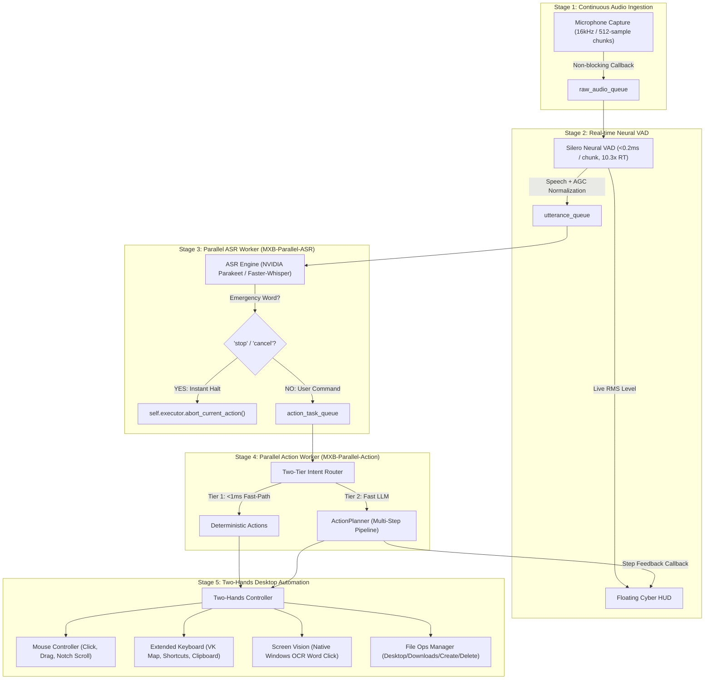

# 🧠 MXB (Machine eXecutive Brain) v2.3
> The Decoupled Parallel AI Desktop Executive Assistant & "Two Hands" Automation Engine for Windows

[](https://github.com/Madhu-36/MXB)
[](https://github.com/Madhu-36/MXB)
[](https://github.com/Madhu-36/MXB)
[](https://github.com/Madhu-36/MXB)
[](https://github.com/Madhu-36/MXB)

**MXB v2.3** is an autonomous desktop executive brain capable of listening continuously and operating your computer in parallel—acting as your digital **"two hands"** (mouse, keyboard, screen vision, and file operations) while you talk.

---

## ⚡ 5-Stage Decoupled Parallel Architecture

MXB eliminates the sequential blocking bottleneck through a fully decoupled, multi-threaded pipeline:



---

## 🦾 "Two Hands" OS Automation Capabilities

| Component | Capabilities | Primary Module |
| :--- | :--- | :--- |
| **Mouse Controller** | Left, right, double, middle clicks; smooth movement; notch scroll; drag-and-drop (`x1, y1 -> x2, y2`); multi-monitor safety boundary clipping. | `engine/mouse.py` |
| **Extended Keyboard** | Full Windows Virtual-Key mapping (`VK_MAP`), system shortcuts (`Win+D`, `Win+E`, `Win+R`, `Win+L`, `Win+I`), browser shortcuts (`Ctrl+T`, `Ctrl+W`, `Ctrl+L`), and structured macro sequences. | `engine/keyboard_ext.py` |
| **Screen Vision & OCR** | Hardware-accelerated Qt screen captures + Windows Native OCR (`winrt.windows.media.ocr`) for word bounding-box detection, text coordinate localization, and clicking screen elements by text label. | `engine/screen.py` |
| **File Operations** | Safe OS file management with alias path resolution (`desktop`, `downloads`, `documents`, `projects`), folder creation, file creation, glob search, file hashing (SHA-256 / MD5), and safe deletion. | `engine/file_ops.py` |
| **Action Planner** | Sliced multi-step execution pipeline with 50ms interval checks for `threading.Event()` abort signals, allowing immediate voice interruption at any moment. | `engine/planner.py` |
| **64-bit Windows Stability** | Explicit ctypes `argtypes` and `restype` definitions on all Windows `user32.dll` APIs (`keybd_event`, `mouse_event`, `GetCursorPos`, `SetCursorPos`), completely eliminating stack canary corruption. | `engine/mouse.py` & `engine/keyboard_ext.py` |
| **Clean TTS Teardown** | Native Windows SAPI `SpVoice` integration with `SVSFPurgeBeforeSpeak` (flag 2) to cancel in-flight audio playback instantly upon stop or interruption. | `engine/tts.py` |
| **Safe Math AST Fast-Path** | Evaluates spoken arithmetic expressions in `<0.04ms` via an abstract syntax tree evaluator without LLM roundtrips. | `utils/math_evaluator.py` |
| **Clipboard History & Search** | Background clipboard monitor with fuzzy search and rapid recall. | `utils/clipboard_monitor.py` |
| **Non-blocking Earcons** | Windows native auditory feedback cues for listen, success, cancel, and error states. | `utils/audio_feedback.py` |
| **Battery & Power Telemetry** | Charge tracking, AC status, and power-saving throttle detection. | `utils/power_manager.py` |
| **Window Geometry & Tiling** | Quadrant corner snapping (`top_left`, `bottom_right`) and Aero Shake background minimizing. | `engine/window_manager.py` |
| **Hardware-Anchored Vault** | Windows DPAPI local encrypted credential storage locked to user login. | `utils/vault.py` |
| **Meteorological Intelligence** | Zero-key worldwide real-time weather and temperature telemetry. | `utils/weather.py` |
| **Process Lifecycle Supervisor** | Windows protected process guards, listening port mapper, and memory ranking. | `utils/process_manager.py` |
| **Screen Color Eyedropper** | 64-bit Windows GDI pixel sampler with Euclidean RGB color name approximation. | `engine/color_picker.py` |
| **Countdown Timers** | Asynchronous countdown timers with natural language duration parsing and auditory alerts. | `utils/timer_manager.py` |

---

## ⚡ Performance Benchmarks

Measured on native 64-bit Windows via `scripts/benchmark_suite.py`:

| Component | Iterations | Avg Latency | Throughput | Status |
| :--- | :--- | :--- | :--- | :--- |
| **Window Geometry Math** | 5,000 | **0.0004 ms** | 2,442,599 ops/s | `PASS` |
| **Duration String Parser** | 3,000 | **0.0021 ms** | 479,233 ops/s | `PASS` |
| **Config Schema Validation** | 1,500 | **0.003 ms** | 387,918 ops/s | `PASS` |
| **Active Window Ctypes Rect** | 1,000 | **0.005 ms** | 191,641 ops/s | `PASS` |
| **RGB Color Approximator** | 3,000 | **0.0061 ms** | 164,445 ops/s | `PASS` |
| **Safe Math AST Evaluator** | 2,000 | **0.029 ms** | 35,044 ops/s | `PASS` |
| **Clipboard Fuzzy Search** | 500 | **0.103 ms** | 9,737 ops/s | `PASS` |
| **TCP Socket Connect RTT** | 1 | **16.64 ms** | - | `PASS` |

---

## 🧪 Comprehensive Verification Suite (92 Tests Across 22 Suites)

MXB includes 22 automated test suites verifying all subsystems:

```powershell
.\.venv\Scripts\python.exe scripts/verify_all.py
```

```text
=================================================================
   MACHINE EXECUTIVE BRAIN (MXB) - FULL SUITE VERIFICATION
=================================================================
[RUNNING] tests.test_architecture...
[RUNNING] tests.test_config_schema...
[RUNNING] tests.test_mouse_safety...
[RUNNING] tests.test_keyboard_macros...
[RUNNING] tests.test_screen_roi...
[RUNNING] tests.test_file_search...
[RUNNING] tests.test_memory_export...
[RUNNING] tests.test_executor_apps...
[RUNNING] tests.test_clipboard_monitor...
[RUNNING] tests.test_active_window_crop...
[RUNNING] tests.test_math_fastpath...
[RUNNING] tests.test_network_diagnostics...
[RUNNING] tests.test_file_preview...
[RUNNING] tests.test_shortcut_validation...
[RUNNING] tests.test_audio_feedback...
[RUNNING] tests.test_power_manager...
[RUNNING] tests.test_window_geometry...
[RUNNING] tests.test_vault...
[RUNNING] tests.test_weather...
[RUNNING] tests.test_process_manager...
[RUNNING] tests.test_color_picker...
[RUNNING] tests.test_timer_manager...
=================================================================
VERIFICATION SUMMARY: 92 tests in 11.35s
Failures: 0 | Errors: 0
=================================================================
>>> ALL ARCHITECTURAL CHECKS & REGRESSIONS PASSED! [STATUS: GREEN]
```

---

## 🚀 Quick Start

```powershell
# 1. Activate Environment
.\.venv\Scripts\activate.bat

# 2. Run All Verifications
python scripts/verify_all.py

# 3. Launch MXB Live
python -u main.py
```

Press `Ctrl+Alt+K` for global kill-switch, `Ctrl+Space` to toggle mute, or simply say **"stop"** at any time to halt running actions.
